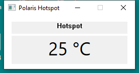

# Minimal Windows hotspot display

`PolarisHotspot.exe` displays only the hotspot and updates once per second. Close the window to stop. It does not start a graphics workload or query memory temperatures.

**Quick start:** with MSI Afterburner installed, download the executable and run it as administrator. The compatible driver is found automatically; no file copying is needed.

Windows 10/11 x64, administrator rights, and exactly one supported PCI device (`1002:699F` or `1002:6FDF`) are required. Detection uses the Windows PCI location; no bench-specific address is compiled in. Other device IDs are deliberately not enabled without validation.

## Register transport

This application needs a compatible RTCore64 register-access driver. A kernel driver is not embedded or redistributed here. A driver already exposing `\\.\RTCore64` can be used directly; an incompatible interface causes a transport error, not a temperature reading.

If no driver is already available, the program searches for a compatible `RTCore64.sys` beside the executable, then in the MSI Afterburner installation recorded in the Windows uninstall registry (32-bit and 64-bit views), and finally in the standard Program Files locations. An existing Afterburner installation can therefore be used directly, without copying its driver or opening the Afterburner application. Custom installations are discovered through their registered installation/uninstall location.

Each candidate is checked before loading. An incompatible candidate is skipped; if no supported file is found, the program displays an error. The supported file has SHA-256:

```text
F1C8CA232789C2F11A511C8CD95A9F3830DD719CAD5AA22CB7C3539AB8CB4DC3
```

The program checks this hash before creating its temporary `PolarisHotspotRTCore` service. It stops/removes that service on normal exit, but does not stop a driver that was already running. Windows must permit loading this driver; the application does not change security settings. If the process is forcibly terminated, a created service can remain and require administrator cleanup.

The collector coordinates indirect SMU access with `Global\Access_PCI`, validates selection/restoration, and writes only the SMU selector. Other monitors and drivers may not honor this mutex; simultaneous monitoring is not universally validated. A failed read stops acquisition and displays an error instead of retaining a stale temperature.

## Build

Open an **x64 Visual Studio Developer Command Prompt**:

```bat
windows\build.cmd
```

Output: `build\PolarisHotspot.exe`. The C++ runtime is linked statically. The executable requests elevation on launch.

For a bounded validation run, optional arguments record raw readings and stop automatically:

```bat
PolarisHotspot.exe --samples 30 --log new-samples.csv
```

The log file must not already exist. Each successful row records monotonic uptime, raw register value, hotspot and confirmed selector restoration. These options do not add anything to the normal window.

## RX550 validation

Tested on 2026-10-27 with RX550 `1002:699F`, revision C7, subsystem `1002:0B04`, Windows 10 Pro x64, display driver `31.0.12027.9001`. One visible 30-sample run at idle reported 25–26 °C; all 30 selector restorations passed. Median interval 1000 ms (984–1000 ms), sample span 28.984 seconds. Exit code 0, same boot, GPU error code 0, hardware watchdog running, no new display-recovery or WHEA events. The temporary driver service was removed on exit.

This validates the Windows collector at idle; the separate Linux evidence validates the register against reference telemetry under load. It is not a new Windows load test or validation of concurrent third-party monitoring.



[Raw samples, executable hash and test summary](../evidence/windows-rx550/).

**v0.1.1 discovery test:** RX550, 10 readings at 25 °C, median interval 1000 ms, 10/10 selector restorations, exit code 0. No adjacent driver file and no RTCore running before launch. The temporary service loaded the driver directly from the Afterburner installation and was removed on exit. Watchdog remained active; same boot and GPU error code 0.
